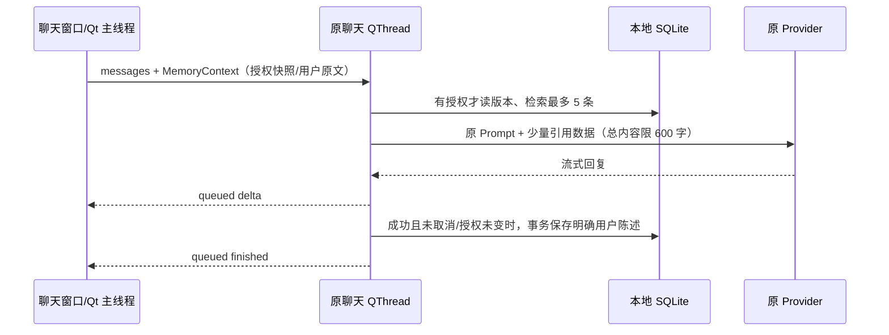

# P0 / P1 长期记忆接入审计

基线：`27495f9b67bd7529c633392927b185e9a2ccd685`；分支：`feature/win10-companion-memory`。
任务书：[DEVELOPMENT_PLAN_WIN10.md](../DEVELOPMENT_PLAN_WIN10.md)。本次只做 P0/P1；后续见 [PR 报告](PR-REPORT-COMPANION-MEMORY-2026-10-12.md)。

## 实际源码与边界

| 能力 | 实际位置 | 本阶段接入/保护方式 |
| --- | --- | --- |
| 两套聊天前端 | `pet/chat/widgets.py`、`legacy_widgets.py` 的 `_begin_generation` | 仅在启用记忆时传入不可变 `MemoryContext`；新版只取用户输入部分，不从附件正文提取 |
| PromptBuilder | `pet/chat/prompt.py` | 原角色人设优先级与历史裁剪保持；增加可选 keyword-only `memory`，后台检索共用引用数据格式 |
| 异步模型请求 | `pet/chat/service.py::_Worker.run` | 在已有 QThread 内先检索、再流式请求、成功后提取用户事实；queued signals 回 UI，不加第二套 provider |
| 会话保存 | `pet/chat/session_store.py` | JSON 异步 writer；未修改。会话与 SQLite 是独立的数据源 |
| 用户目录 | `pet/config.py::Config.dir/path` | Win10 默认 `%APPDATA%/<APP_DIR_NAME>`；不同打包变体按原目录隔离。SQLite 与配置同目录，不在源码或 PyInstaller 临时目录 |
| 配置 | `chat` 特例域、ChatSettings | 新增两个严格布尔值，默认 false；沿用 `_merge_chat_data`、reload 和 set_chat_settings，不新增顶层键 |
| 管理入口 | Settings System / AI 与对话 | `memory_enabled`、`memory_auto_extract`、`memory_manage` 三行；两个授权立即保存，管理 CRUD 后台执行 |
| 动画、气泡、多宠 | `AppShell`、`OverlayShell`、`PetWindow`、`MovieLibrary` | 未修改动画/渲染/拖拽；记忆不发主动气泡、不启动 TTS、不截图 |
| 投喂、头部框、待办 | `file_eater.py::eat_paths`、`catalog.character_head_box`、现有 todo 服务 | 仅确认接缝；本阶段不修改、不增加 AI 反馈或提醒 |

## SQLite 与身份

当前 schema version 为 2（`PRAGMA user_version`）。

- `memory_meta(id=1, revision)`：人工写入、编辑、删除以及完成提取时递增；请求记录开始时版本，版本变化则丢弃旧提取结果。
- `memories(id, subject, topic, content, kind, source, created_at, updated_at, content_key)`：同一 subject/topic 唯一，同一 subject/规范化内容也唯一。来源仅 `explicit`、`statement`、`manual`，不存 assistant 输出、API Key 或完整聊天副本。
- 主题示例 `preference:color`、`fact:name`、`event:考试`；新偏好/否定覆盖同主题旧内容。人工编辑保留主题。最多 500 条，超额按更新时间淘汰旧记录，不维护无限缓存。
- 默认 `subject=local-owner`：同一用户数据目录内跨角色、跨会话及多窗口共享事实；每个配置文件的授权仍独立。不同 OS 用户/配置目录/打包变体不共享。
- 每次操作在执行它的线程中创建并关闭连接；busy timeout 300ms、短事务、参数化 SQL、默认 DELETE journal、secure_delete。Windows 10 实测前不启用 WAL。
- 首次初始化从版本 0 迁移；版本 1 升级为 2 前通过 SQLite backup API 建一致快照、补内容去重索引。未知新版本、损坏、锁超时均保留原文件、停止本次记忆操作，普通聊天继续。
- 管理界面提供同目录备份；数据库不是加密存储，依赖账户目录权限。删除记录不删除历史 JSON 或已有备份，界面明确提示这一区别。

## 提取和检索范围

自动提取是本地保守语法，**不产生额外 DeepSeek 请求**。接受用户本人确定的喜好、称呼/属性及带时间词的事件，例如“我喜欢蓝色”“我的工作是教师”“我下周要考试”。关闭自动提取后只接受“请记住/记住/记得”前缀。问句、假设、不确定、第三人称、凭据/支付/病史过滤；P1.1 另拒绝邮箱、电话/社交联系方式、精确住址、证件/出生/收入等不必要私人信息及 URL/用户路径；保留普通日期、城市粒度位置和技术兴趣；无法识别的表达不猜测，用户可在管理界面手动录入。

P1.1 检索先识别明确的个人回忆总览、喜好总览和具体主题，再以中文双字/英文词及少数主题别名评分。总览按最近记录限制返回；喜好只取偏好（含手工确认的喜好），具体问题不扩大成全库。最多 5 条、600 字，记录日期随引用发送。只发送匹配记忆，消息明确标为 JSON 引用数据并禁止当作指令。关闭读取时不打开 SQLite。检索不是向量或 LLM 语义搜索，复杂改写可能无命中。

旧库私人记录仍可在管理界面查看/删除，但检索不发送，不自动抹除用户文件。过滤是保守规则，不保证识别所有语言、编码或私人含义。加固证据见 [P1.1 报告](PR-REPORT-COMPANION-MEMORY-HARDENING-2026-10-12.md)；后续仅计划 [P2](P2-PROACTIVE-CHAT-IMPLEMENTATION-PLAN.md)。

授权变化会使当前进程的旧 MemoryContext 失效，即使设置写盘失败也不会让旧后台任务重新写入；失败明确提示重试保存。磁盘授权在请求开始和完成时重新检查，用文件修改时间使跨进程配置变动也取消旧写入。删除/编辑通过 SQLite revision 使在途结果失效。已经发送的 API 请求、已有会话历史不会被追溯抹除。

## 设置契约

| setting_id | domain/group | 默认/依赖 | 提交/恢复/迁移 |
| --- | --- | --- | --- |
| `memory_enabled` | AI 与对话 / 长期记忆 | false；Chat 变体、所有平台 | 立即保存；旧配置无此键按 false，严格只接受 JSON true；恢复默认关闭 |
| `memory_auto_extract` | AI 与对话 / 长期记忆 | false；依赖 memory_enabled | 立即保存；开关关闭暂停提取，保留已授权偏好；不回溯历史，不删已有记忆 |
| `memory_manage` | AI 与对话 / 长期记忆 | 一次性管理命令，非持久偏好 | 关闭读取仍可由用户显式打开查看/删除；SQLite 操作后台执行 |

复用 SettingRow/SettingsSection/ResponsiveActionRow，搜索沿用现有动态行索引；无新的一级能力域。旧 AI 设置窗口保存时读取最新 ChatSettings，不丢失这两个字段。no-chat 变体不构造该页，不导入新记忆模块。

## 本次 P0 基线证据

Linux 云容器、Python 3.12.14、PySide6 6.12.0：

- 原聊天/SessionStore 聚焦：178 passed, 1 skipped（14.43s）。
- 原 CI 主套件：4213 passed, 37 skipped（251.89s），20 warnings，退出 0。本次重新执行，与上次环境设置的 4207 数字分开。
- 基线也有 `agent-monitor-dsh` 向已删除 Qt signal 发射的线程警告，堆栈在未修改的 `agent_link.py`；记录为既有生命周期问题，不在 P1 中屏蔽或扩大修复。
- `tests/smoke.py` 的 51 素材断言过时；当前库 106 项，包含静态图零时长。单独复跑并记录，不修改旧测试来伪装通过。
- 使用 MIT 项目代码；角色素材有非商业条款（见 THIRD_PARTY_NOTICES）。本阶段不引入第三方依赖/素材，不打包或声称 Win10 已验证。
