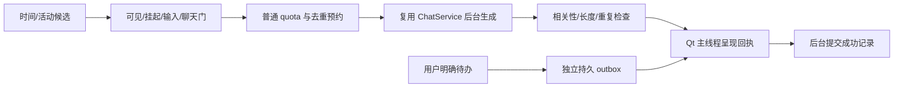

# P2 主动 AI 问候与提醒：待确认的实现方案

**状态：PLAN ONLY / NOT IMPLEMENTED。** 本次提交只实现 P1.1，不增加 P2 模块、计时器、配置、API 请求或气泡。
审计基线：[P1.1 报告](PR-REPORT-COMPANION-MEMORY-HARDENING-2026-10-12.md)，原 P1 提交 `c81f26f`。
约束来自 [DEVELOPMENT_PLAN_WIN10.md](../DEVELOPMENT_PLAN_WIN10.md) 与本轮用户指令；范围到 P2，不做 P3–P5。

## 1. 配置及行为契约

用户确认实施后，采用以下目标配置：

```json
{"proactive_chat":{"enabled":true,"greetings":true,"break_reminders":true,"water_reminders":true,"scheduled_reminders":true,"use_memory":true,"daily_limit":10,"min_interval_minutes":30,"quiet_hours":null,"avoid_semantic_repeats":true}}
```

旧配置缺少整个域时默认关闭，避免升级自动产生收费请求；显式用户配置按上述值启用。严格解析 bool/int，bool 不当数字；daily_limit 0 表示禁止普通话语，范围 0–20；min_interval_minutes 建议范围 15–180，目标 30；quiet_hours=null 原样保留，不补夜间静默区间。普通话语有资格发言不等于每 30 分钟必发。

greeting、水、休息共用一个本地日 quota=10、跨日仍保留最后成功显示的 30 分钟间隔。到期日程不进入此 limiter。`use_memory` 还必须同时满足 P1 的 `chat.memory_enabled`；不会顺带开启自动记忆。关闭主动 AI 不关闭或删除既有待办，也不改变其他原版 TTS/主动识屏偏好。本增强只生成文字，不调用任何语音/截屏入口。

## 2. 实际源码接缝与必须补齐的接口

| 实际位置 | 当前行为/风险 | P2 建议改动 |
| --- | --- | --- |
| `pet/app.py::AppShell.__init__/start`、`_sync_todo_service` 附近 | 进程级服务生命周期现成，多宠共享 AppShell | 新服务仅由 AppShell 持有一次；按配置懒启动/更新/关闭，不为每只鱼建立 timer |
| `AppShell._on_about_to_quit/_on_session_end` | 已有退出、注销/关机冻结 | 作废 generation，取消在途主动请求、停止 timer、有界保留 worker；关机路径不额外派生进程/等待网络 |
| `AppShell.win` | legacy 返回 PetWindow；overlay 返回 OverlayShell | 每次呈现动态取当前 host；弱引用目标，避免热切换后对已销毁窗口调用 |
| `pet/chat/service.py::ChatService/_Worker`、`providers.py` | 原流式网络后台 QThread；`send()` 会 stop 当前服务请求 | 复用类/provider，用 AppShell 专属主动 ChatService 实例，不能拿手动窗口的 service.send() 发主动消息；手动开始时主动取消/延后 |
| `ChatService._finished`、`AppShell._on_global_chat_finished` | 所有实例完成都会触发全局 listener；隐藏时可能产生岛预览 | 增加兼容默认的 request origin/`notify_global_finished` 控制；主动请求不触发这条手动完成监听，避免隐藏期预览、双气泡与无意打扰 |
| `pet/companion/memory_context.py::completed` | 成功回复后从 user_text 提取，不能用于合成主动提示 | 只读记忆上下文（prepare 检索，completed 无操作）；主动提示/AI 回复均不得进入事实写入或伪装 user ChatMessage |
| `PromptBuilder.effective_system_prompt`、`memory_message` | 已有角色人设和带日期的引用数据 | 共用人设/引用格式；主动模板单独组合，少量相关记忆与最近去重摘要；不带窗口标题、文件名、截图、原会话整库 |
| `OverlayShell.show_bubble`、`PetWindow.show_bubble` | **返回 None**，有门禁时静默不显示 | 增加窄的公开 `try_show_bubble(...) -> bool`/送达回执，保留原 show_bubble 协议；只改呈现接缝，不重构动画 |
| `sprite_bubble.py::SpriteBubbleFollower.show` | 已返回是否真实展示 | overlay 回执复用它，但仍必须先走可见、飞行、设置抑制、sticky/alert 门禁；不能绕过门禁直接调私有方法 |
| `pet/todo_reminder.py::TodoStore/advance_todo_state/TodoReminderService._on_tick` | once/daily、lead/due；宽限外静默盖戳归档；先保存 fired_slot 再 `_notify_fire`，无送达回执 | 见第 5 节：显式到期的 durable outbox、恢复/回执；不能照搬后宣称不会漏提醒 |
| `pet/todo_panel.py`、`new_todo_item` | 用户明确创建结构化待办（id/date/time） | 沿用唯一编辑入口与 id；P2 不从 SQLite 记忆“明天/下周”创建任务，不增加第二套 todo 表 |
| `OverlayShell._on_suspend_changed`、session_watcher、fullscreen watcher | 锁屏/睡眠是 driver.suspended；overlay 可能仍 isVisible | 拓扑无关的状态快照必须含 suspended，不能只靠 isVisible；复用挂起/全屏事件，不启动第二套截屏探测 |
| `vision.get_system_idle_seconds` | 系统最近输入时长，可读 Win32 LastInputInfo | 只复用纯输入空闲探针，不调用捕获屏幕函数；近期输入则延后普通主动话语 |
| `multi_window_shared.MultiWindowProxy.show_bubble` | 可能扇出多个可见窗 | 不用于主动问候；全局选一个可用 host，确保多宠只冒一次 |
| `proactive_limiter.py::ProactiveLimiter` | 识屏预设、最低 daily cap=1、熔断、dry_run，与 P2 配额语义不同 | 不直接复用计数文件/预设，不让识屏占 P2 的 10 次；参考可注入时钟与原子持久化经验 |

## 3. 分层与生命周期

拟新增的实际模块（确认后逐个实现，当前不创建空文件）：

- `pet/companion/proactive_config.py`：纯配置解析；Config 默认、reload 与 snapshot 三处登记，遵守 SETTINGS-CHANGE-GATES。
- `proactive_state.py`：用户目录 `companion_proactive.sqlite3`；短事务存日账、预约、utterance、outbox/重试状态。与 P1 数据库分开，避免频控写入影响 memory revision。
- `proactive_limiter.py`：纯决策/注入时钟，所有普通类别共用 quota/间隔，含 API 尝试退避和有限重试费用门。
- `proactive_repetition.py`：词形归一、字符/词相似度、语义类别标签和事件键。不依赖额外 embedding API。
- `proactive_scheduler.py`：事件候选与状态门；Qt timer 只快照 UI 状态/投递，SQLite/网络在串行后台任务中。
- `proactive_service.py`：AppShell 单例协调（用户聊天优先、单飞、generation、取消、presentation 回执）。
- `proactive_prompts.py`：时间/类别/角色/少量记忆构造；`todo_delivery.py`：在原待办上接持久送达，不建立第二套日程 UI。



待确认的场景默认：问候按本机上午/下午/晚上时段每段最多一次；喝水和休息按有资格的活动时间候选，不按所有 timer tick 调 API。睡眠/长事件空窗不计为久坐，恢复后不回放一串错过的普通候选。只读 OS 时间/输入元信息，API 不携带私人屏幕数据。时段边界可在测试注入，不新增 P5 专家设置。

## 4. 模型请求、费用和语义去重

1. 调度时先判定所有状态、全局额度、事件键及类别冷却。UI 正在手动聊天或输入、隐藏/全屏/挂起、重要审批气泡占位时不发普通请求；手动消息到来立即取消主动任务，旧结果不能覆盖新状态。
2. 拷贝现有 active ProviderConfig，后台解析当前凭据，不修改用户手动 provider 对象。主动输出上限约 96 tokens，目标 1–2 句/80 字，网络超时有界，保留 TLS 校验。
3. `use_memory && memory_enabled` 才取少量经过 P1.1 隐私过滤的相关事实；专用只读上下文，不调用 MemoryContext.completed，不写 user ChatMessage/SessionStore。主动输出仅入 utterance log。
4. 最近主动 utterance、UTC 时间、实际语义类别 tags、本地日、来源事件 id 持久化；最多保留最近 100 条/30 天（最终范围以测量为准），只给模型最多 3 条必要摘要。不发送整个记忆/日志库。
5. 文本归一、中文双字/英文词相似度，加 drink（喝水/补水/饮水）、break（久坐/起身/活动）、greeting 等标签。标签冷却防止换措辞反复催同一主题；生成问候夹带喝水时也记录 drink 标签。明确 due 的不同事件不得因相似标题被普通去重吞掉。
6. 每个候选最多原请求 + **一次**重复/空内容重生成；成功显示之前不递增普通 sent_count。预约使并发不能同时拿最后一个 quota。另设 request-attempt 退避与每日 token/请求硬上限（建议不超过普通消息上限 ×2），不把 401/429/超时无限重试。401 暂停到凭据/配置变更；429 按 Retry-After/有界退避。
7. 普通生成失败/语义重复仍不能解决时跳过或延后，不循环播放固定喝水/问候台词。明确到期由原本地可信待办文字保证送达，不等待模型润色；API 失效时原动画/待办继续。

跨日按本机时区的本地日计数，不假设 UTC 日期或用户常驻 Asia/Shanghai。持久化 last_display_utc 与每日本地账；进程内同时用 monotonic 控制最短间隔。时间回拨不得清零旧日账或绕过冷却；跨日保留跨午夜最后显示间隔；异常大跳/时区变更保守延后普通候选。重启只恢复持久状态，不能把新 monotonic 原点当成旧值。

## 5. 明确日程的可靠恢复与送达

原 TodoStore 是唯一日程来源，once/daily 和 lead/due id 保留；“明天/下周”记忆只是引用事实，不生成 due_at，也不读取个人日历。自然语言新增日程若未来扩展，必须解析后经 UI 确认，本 P2 首次实现可继续仅使用现有面板。

关键改动提案：

- 给 TodoReminderService 加可选 durable dispatcher 接缝；启用 P2 日程扩展时，先把候选 `{todo_id, occurrence, phase, title, time, schedule_version}` 插入 SQLite outbox（唯一 event_key），后台确认成功后再写原 fired slot。旧功能关闭增强时保留原语义。
- enqueue 先于 JSON 盖戳：退出发生在两者之间，重启再次生成同一 event_key 只复用 outbox，不重复新建；发生在盖戳之后，pending outbox 仍可恢复。写失败不盖戳，且提醒不转成已送达。
- 当前 `advance_todo_state` 的宽限外跳过必须分模式处理：开启增强后，对启用期间已明确创建、尚未送达的 once 到期保存一个恢复候选；daily 只恢复最近一次 occurrence，避免睡眠数天后连发历史队列。关闭/删除的条目不复活。不会把原来归档的多年旧任务迁移成一批提醒。
- 日程直接进入独立 priority queue，不调用普通 limiter，不因 daily_limit=0 或 quota=10 拒绝。隐藏/全屏/挂起时排队，恢复后显示带“延迟/恢复”的文字。只显示桌宠气泡；不新增 TTS 或系统语音；旧系统通知偏好不由本增强擅自改变。
- 本机时区创建/展示与未来 occurrence 的 UTC 转换需明确校验，不能把 Windows 时区名称直接当作 IANA；现有 naive date/time 继续解释为 OS 本地日程，测试注入时区/DST。不是依据记忆里的相对时间推断日期。
- 多宠只选择一个可显示 host；相同 event_key 正常运行、重启、唤醒幂等。没有可用 host 时保留 pending，而非盖戳静默丢弃。

**不能虚称 UI 显示和 SQLite commit 是一个原子事务。** outbox 使用 pending/presenting/delivered 状态。正常显示回执后 commit。崩溃恰在显示与回执之间时无法证明“恰好一次”：普通话语保守保留未决 quota 预约避免轰炸；日程以不漏为先，恢复一条明确标注“送达状态未确认”的提示并记录恢复事件，承认临界情况可能重复。这个权衡需在 P2 实机验收中明确测试。

## 6. 测试计划（确认后测试先行）

| 领域 | 必须断言 |
| --- | --- |
| 配置 | 给定 JSON 生效；null quiet_hours 不变；非法类型/值回退；旧配置关闭；开关热更新停止新请求；原设置不丢失 |
| 共享普通频控 | greeting/water/break 总计第 11 条不显示；未满 30 分钟不请求；失败/被取消/被门禁拒绝不算成功；最后一份额度并发预约 |
| 日账/时钟 | 重启读计数；跨本地午夜和 UTC 午夜不同；跨午夜间隔；回拨不重置；DST/时区变化；睡眠不计久坐、不回放普通队列 |
| 去重 | 文字重复、标点改写、喝水/补水及休息/活动语义同类；混合提醒 tags；重复最多一次重生成；记录重启保留；不同 due event 不相互去重 |
| 模型 | fake Provider 检查实际 payload、人设/少量记忆/长度；401/429/超时/空内容/重复返回；取消与费用硬限；UI timer 在请求/DB 等待时仍运行 |
| 记忆隐私 | use_memory=false 或 memory_enabled=false 不开库；旧敏感记录不发送；主动合成输入与 AI 回复均不写长期记忆；删除/关闭使旧任务失效 |
| 手动竞争 | 手动聊天启动取消主动、旧结果不落手动会话；request ids 不串；主动完成不触发岛全局 listener/预览；多窗只有一个请求/一个气泡 |
| 呈现回执 | legacy/overlay 的 try_show_bubble true/false；隐藏、suspended、飞行、设置/审批占位返回 false；角色切换/销毁前后不会向死对象发射 |
| 到期日程 | quota=10/min_interval 未到/daily_limit=0 仍送达；enqueue 失败不盖戳；enqueue 后/盖戳后/显示临界退出再恢复；关闭/编辑/删除任务取消旧版本候选 |
| 过期恢复 | once 宽限外恢复一条；daily 只恢复最近 occurrence；恢复过多合并可操作待办摘要不静默消失；旧归档任务不复活 |
| 文字模式 | 为 TTS、截屏、麦克风、摄像头设拒绝探针；主动发言路径零调用；原功能用户设置保持 |
| 原版回归 | P1/聊天/SessionStore、todo、气泡/点击/拖动/文件投喂、架构预算与 no-chat 变体；Ruff、完整 CI 分组、时序族满载 3 遍 |

持久化用临时真实 SQLite/JSON；网络/OS 边界注入 fake；时序用 Event/queued signals，不固定 sleep 赌时序。每个小增量保留 red→green 记录。预计分四个审查单元：配置/状态/limiter → scheduler/去重 → provider/只读记忆/呈现 → todo outbox/恢复与整体验收；每单元通过才接下一层。

## 7. Windows 10 验收与本次停止点

Windows 10 22H2 x64 实机需确认：锁屏/睡眠/全屏游戏、GetLastInputInfo、系统时区/DST、100/125/150% DPI、单/多角色、后台请求取消、关机/注销收口、SQLite 锁与恢复、真实 DeepSeek payload/费用和文字气泡。Linux offscreen 只证明相应自动化路径，不等于这些能力已验。

本次 **不应用目标配置、不启动 P2、不生成提醒或询问费用凭据**。待用户确认该方案后再实现上述分层测试与接入。
